  

- 👋 Hi, I’m @njbarbara
- 👀 I’m interested in software development and game design 
- 🌱 I’m currently learning .NET MAUI and C++
- 📫 You can reach me at barnaj1910@gmail.com, if you want to talk about development or work on a project together.
- 🌐 Portfolio → [najib-barbara.fr](https://najib-barbara.fr)

<h3 align="left">Languages and Tools:</h3>

               <a href="https://vuejs.org/" target="_blank" rel="noreferrer">                  </a> 

  

